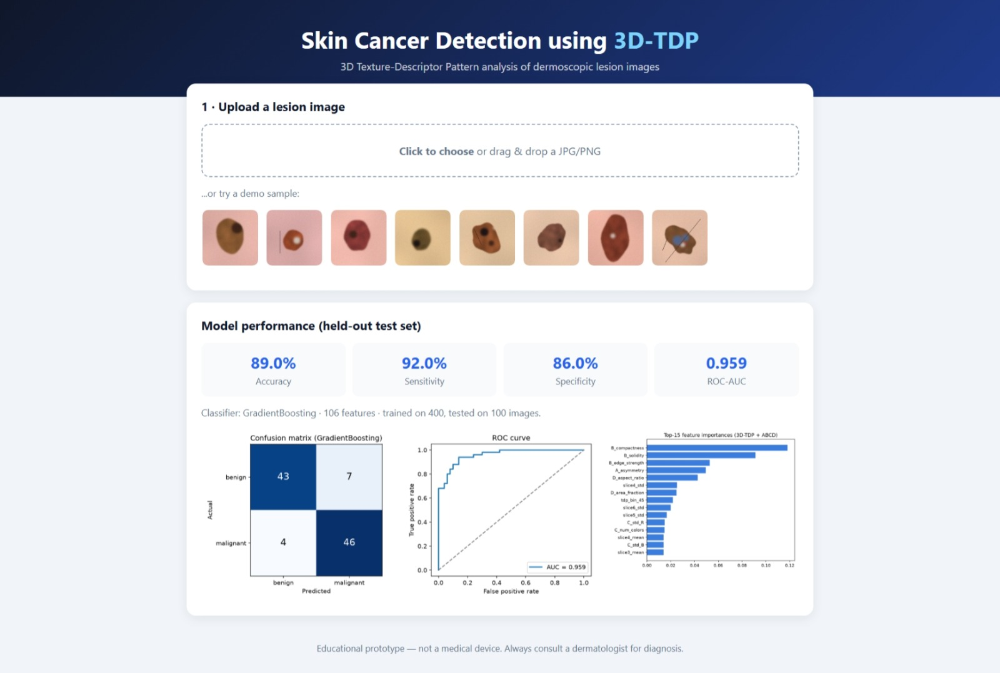
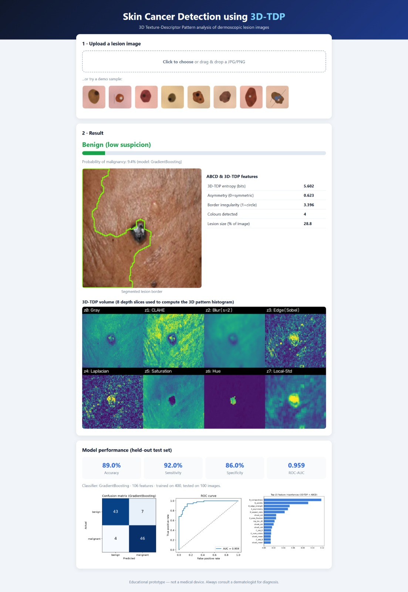

# Skin Cancer Detection with Deep Learning (ISIC)

A set of Jupyter notebooks for detecting skin cancer (melanoma) from skin lesion images, built around the ISIC (International Skin Imaging Collaboration) Kaggle competitions. The project walks through the full machine learning workflow: downloading the data, cleaning and formatting it, augmenting the images, and training image classification models.

> **Credit:** This project is based on the original repository
> [Alton1998/ISIC-2024-Skin-Cancer-Detection-with-3D-TBP](https://github.com/Alton1998/ISIC-2024-Skin-Cancer-Detection-with-3D-TBP).
> All original work belongs to its author.

---

## Table of Contents

1. [Overview](#overview)
2. [Project Structure](#project-structure)
3. [Requirements](#requirements)
4. [Installation](#installation)
5. [Getting the Dataset](#getting-the-dataset)
6. [How to Run](#how-to-run)
7. [Troubleshooting](#troubleshooting)
8. [Notes and Limitations](#notes-and-limitations)
9. [Disclaimer](#disclaimer)
10. [License and Acknowledgements](#license-and-acknowledgements)

---

## Overview

Skin cancer is most treatable when it is found early. The ISIC competitions provide labeled skin lesion images so researchers can build models that help tell benign lesions from malignant ones.

This repository contains notebooks that cover:

- **Data download:** fetching the competition data from Kaggle.
- **Data formatting:** loading metadata and images into a clean, model-ready structure.
- **Data augmentation:** creating extra training variations of images (flips, rotations, etc.) to help the model generalize.
- **Model training:** training image classifiers, including a model trained from scratch and a Vision Transformer.

## Project Structure

| File | Purpose |
|------|---------|
| `Downloader.ipynb` | Downloads the dataset from Kaggle |
| `Data Formatter.ipynb` | Reads and prepares the metadata and images |
| `Data Augmenter.ipynb` | Applies image augmentation |
| `Trainer.ipynb` | Model training notebook |
| `Trainer_Scratch.ipynb` | Trains a model from scratch |
| `Vision Tranformer.ipynb` | Trains a Vision Transformer model |
| `docker-compose.yml` | Optional Docker setup |

## Requirements

- Python 3.10 or 3.11
- VS Code with the **Python** and **Jupyter** extensions (or JupyterLab)
- A free [Kaggle](https://www.kaggle.com) account
- Several GB of free disk space for the data
- An NVIDIA GPU is strongly recommended for training. Without one, use Kaggle Notebooks or Google Colab, which offer free GPUs.

Main Python libraries (install any others when a notebook reports a missing module):
`jupyter`, `ipykernel`, `pandas`, `numpy`, `matplotlib`, `scikit-learn`, `opencv-python`, `pillow`, `tqdm`, `h5py`, `kaggle`, `torch`, `torchvision`

## Installation

**1. Clone or download the repository**

```bash
git clone https://github.com/<your-username>/<your-repo-name>.git
cd <your-repo-name>
```

Or click **Code → Download ZIP** on GitHub and extract it.

**2. Create and activate a virtual environment**

Windows (PowerShell):

```powershell
python -m venv venv
venv\Scripts\activate
```

macOS / Linux:

```bash
python -m venv venv
source venv/bin/activate
```

**3. Install the dependencies**

```bash
python -m pip install --upgrade pip
pip install jupyter ipykernel pandas numpy matplotlib scikit-learn opencv-python pillow tqdm h5py kaggle
pip install torch torchvision
```

**4. Open the project in VS Code**

Open the folder, open any `.ipynb` file, click **Select Kernel**, and choose the `venv` environment.

## Getting the Dataset

1. Log in to Kaggle and open the competition page:
   - ISIC 2024: <https://www.kaggle.com/competitions/isic-2024-challenge>
   - SIIM-ISIC Melanoma (2020): <https://www.kaggle.com/competitions/siim-isic-melanoma-classification>
2. Click **Join Competition / I Understand and Accept**. Downloads fail with a `403 Forbidden` error until you accept the rules for that competition.
3. Create an API token in Kaggle: **Settings → API → Create New Token**.
4. Set the token in your terminal (Windows PowerShell shown):

   ```powershell
   $env:KAGGLE_API_TOKEN="your_token_here"
   ```

   Never commit your token to GitHub.
5. Download the data:

   ```bash
   kaggle competitions download -c isic-2024-challenge -p data
   ```

6. Extract the zip into the `data` folder.

## How to Run

Run the notebooks from top to bottom, in this order:

1. `Downloader.ipynb` (skip it if you downloaded the data manually)
2. `Data Formatter.ipynb`
3. `Data Augmenter.ipynb`
4. One training notebook: `Trainer.ipynb`, `Trainer_Scratch.ipynb`, or `Vision Tranformer.ipynb`

Before running each notebook, check the first cells for file paths (such as `/kaggle/input/...`) and change them to match your local `data` folder.

## Troubleshooting

| Problem | Fix |
|---------|-----|
| `403 Forbidden` when downloading | Accept the competition rules on Kaggle and verify your phone number in Kaggle Settings |
| `FileNotFoundError` | The path in the notebook does not match your folder. Update it to your data location |
| `ModuleNotFoundError: No module named 'xyz'` | Run `pip install xyz`, then re-run the cell |
| Training is extremely slow or runs out of memory | Use a GPU, reduce the batch size or image size, or run on Kaggle Notebooks / Google Colab |
| PowerShell blocks `venv\Scripts\activate` | Run `Set-ExecutionPolicy -Scope Process Bypass` and try again |

## Notes and Limitations

- Some notebooks may expect the folder layout of the 2020 SIIM-ISIC Melanoma data (for example `siim-isic-melanoma-classification/train.csv`). The 2024 data uses different file names (such as `train-metadata.csv`), so paths and column names may need to be adjusted.
- There is no `requirements.txt` yet, so dependencies are installed as the notebooks need them.
- Results depend on the dataset used, your hardware, and the training settings you choose.

## Disclaimer

This project is for **education and research only**. It is not a medical device and must not be used to diagnose, treat, or make decisions about any medical condition. Always consult a qualified healthcare professional about skin concerns.

## License and Acknowledgements

- Original project by [Alton1998](https://github.com/Alton1998).
- Dataset provided by the [International Skin Imaging Collaboration (ISIC)](https://www.isic-archive.com/) through Kaggle. Please follow the competition's data usage rules.
- Add your own license here (for example MIT) if you publish your version, and check the original repository's license before reusing its code.


@"

## Screenshots

<p align="center">
  
</p>
<p align="center"><em>Figure 1.</em></p>

<p align="center">
  
</p>
<p align="center"><em>Figure 2.</em></p>
"@ | Add-Content -Path README.md -Encoding utf8